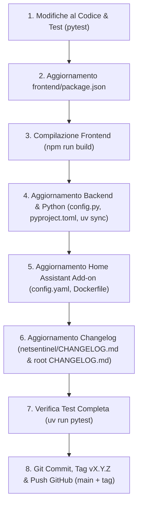

# NetSentinel — Linee Guida Operative per Agenti IA & Sviluppatori

Questo documento definisce le **regole tassative, i flussi di lavoro e la checklist di rilascio** che qualsiasi assistente IA (o sviluppatore) deve rigorosamente seguire quando lavora su questo repository.

---

## 🏗️ 1. Architettura del Progetto

NetSentinel è composto da tre componenti integrati:

1. **Backend Python (`/backend`)**:
   - Framework: FastAPI, Uvicorn, SQLAlchemy asincrono su SQLite WAL (`/data/netsentinel.db`).
   - Correlazione & Topologia: NetworkX (`TopologyGraph`), deduzione euristica L2/L3 e simulazione What-If.
   - Gestione Dipendenze: Astral `uv` con Python 3.12 (`pyproject.toml`, `uv.lock`).

2. **Frontend SPA (`/frontend`)**:
   - Stack: React 18, TypeScript, Vite, TailwindCSS, `@xyflow/react` (XYFlow), Lucide Icons.
   - Output compilato: `frontend/dist/` (servito direttamente dal backend FastAPI in produzione e nell'add-on).
   - Lettura versione: Visualizzata nella Topbar importando `package.json` (`v{packageJson.version}`).

3. **Home Assistant Add-on (`/netsentinel`)**:
   - Configurazione Supervisor: `netsentinel/config.yaml`.
   - Immagine Docker runtime: `netsentinel/Dockerfile` (estende `ghcr.io/marcomatrella/netsentinel:X.Y.Z`).
   - Changelog visibile in HA: `netsentinel/CHANGELOG.md` (formato specifico per HA Supervisor).

---

## 📋 2. Checklist Obbligatoria per Nuove Versioni / Pacchetti di Modifiche

Ogni volta che si conclude un ciclo di sviluppo, bugfix o nuova feature e si prepara una nuova versione `X.Y.Z`, **la versione DEVE essere aggiornata in modo sincronizzato e consistente in TUTTI i file indicati di seguito, SENZA ECCEZIONI**.

### 🔹 Ordine di Esecuzione dei Passaggi:



---

### 📝 3. Dettaglio dei File da Aggiornare

| # | File | Posizione / Proprietà | Esempio / Istruzione |
|---|---|---|---|
| **1** | `frontend/package.json` | `"version": "X.Y.Z"` | Aggiornare il campo `version` |
| **2** | `frontend/` (Build) | `npm run build` | **OBBLIGATORIO**: compila il nuovo bundle statico in `frontend/dist/`. Se non lo esegui, l'header bar continuerà a mostrare la versione vecchia! |
| **3** | `backend/app/config.py` | `app_version: str = "X.Y.Z"` | Aggiornare il default della classe `Settings` |
| **4** | `pyproject.toml` | `version = "X.Y.Z"` | Aggiornare la sezione `[project]` |
| **5** | `uv.lock` | Eseguire `uv sync` | Rigenera il lockfile con la versione corretta |
| **6** | `netsentinel/config.yaml` | `version: "X.Y.Z"` | Utilizzato da Home Assistant Supervisor per rilevare aggiornamenti |
| **7** | `netsentinel/Dockerfile` | `ARG BUILD_FROM=ghcr.io/marcomatrella/netsentinel:X.Y.Z` | Punta all'immagine GHCR pubblicata dalla CI/CD per quella versione |
| **8** | `netsentinel/CHANGELOG.md` | Inserire `## X.Y.Z` in cima | Previene l'errore HA *"No changelog found for app..."*. Deve contenere un riassunto in italiano |
| **9** | `CHANGELOG.md` (root) | Inserire `## [X.Y.Z] - YYYY-MM-DD` | Changelog ufficiale del repository |

---

## 🧪 4. Regole sui Test Automatizzati

1. **Eseguire sempre la suite di test prima di rilasciare**:
   ```bash
   uv run pytest
   ```
   Tutti i test devono risultare `PASSED` (zero fallimenti o errori).

2. **Se introduci una nuova funzionalità o risolvi un bug**:
   - Aggiungere o aggiornare il relativo test in `tests/backend/` (es. in `test_m3_topology_and_deduction.py`, `test_m2_correlation_scenarios.py`, ecc.).
   - Verificare che il test copra sia il percorso nominale sia i casi limite.

---

## ⚠️ 5. Vincoli Architetturali e Guardrail Fondamentali

1. **Nessun `HEALTHCHECK` nel Dockerfile**:
   - **NON** aggiungere direttive `HEALTHCHECK` in `Dockerfile` o `netsentinel/Dockerfile`.
   - In Home Assistant OS/Supervisor, una direttiva `HEALTHCHECK` non configurata al millimetro blocca l'avvio dell'add-on nello stato perenne `AppState.STARTUP`. La liveness è gestita nativamente dall'endpoint `/healthz` e da Home Assistant Ingress.

2. **Raggiungibilità LAN Locale vs Guasti WAN / Router**:
   - Una caduta della WAN (es. `1.1.1.1` o uplink del provider) **NON** deve mai impostare gli apparati della LAN locale come offline (`unreachable`). La rete interna rimane funzionante (`ok`).
   - Una caduta del Router **NON** deve portare offline i dispositivi attestati sullo switch locale (Switch, NAS, Access Point, Home Assistant). Solo i dispositivi che risiedono dietro al router (come la WAN o host collegati solo alle sue porte/Wi-Fi) diventano irraggiungibili dal Vantage Point.
   - Nodi raggiungibili dal Vantage Point vengono marcati come `unreachable` **esclusivamente** se hanno perso alimentazione fisica (`kind == "power"` da PoE switch o UPS).

3. **Vantage Point Univoco**:
   - Nella topologia può esistere **un solo** dispositivo con il ruolo `vantage_point` (di norma l'host locale Home Assistant / NetSentinel).
   - In caso di import o deduzione con duplicati, il sistema attiva l'auto-healing mantenendo solo il nodo locale.

4. **Compatibilità Ingress & Dual HTTP Binding**:
   - NetSentinel ascolta simultaneamente su due socket HTTP:
     - Porta `8099`: riservata all'Ingress di Home Assistant (gestisce header `X-Ingress-Path` e tag `<base href="...">`).
     - Porta `8181` (o custom): Web UI esterna diretta.
   - Non rompere la logica di rewrite dei percorsi statici in `backend/app/main.py`.

---

## 🚀 6. Procedura di Release su GitHub

Quando tutti i file della checklist sono stati aggiornati e i test sono verdi:

```bash
# 1. Commit delle modifiche
git add .
git commit -m "fix/feat: descrizione sintetica delle modifiche e rilascio vX.Y.Z"

# 2. Creazione del tag Git annotato
git tag -a vX.Y.Z -m "Release vX.Y.Z: descrizione sintetica"

# 3. Push su GitHub (sia il branch che il tag)
git push origin main
git push origin vX.Y.Z
```

> [!IMPORTANT]
> Il push del tag `vX.Y.Z` scatena automaticamente la GitHub Action `.github/workflows/cd.yml`, che compila le immagini multi-arch (`linux/amd64`, `linux/arm64`) e le pubblica su GitHub Container Registry (`ghcr.io/marcomatrella/netsentinel:X.Y.Z`).
