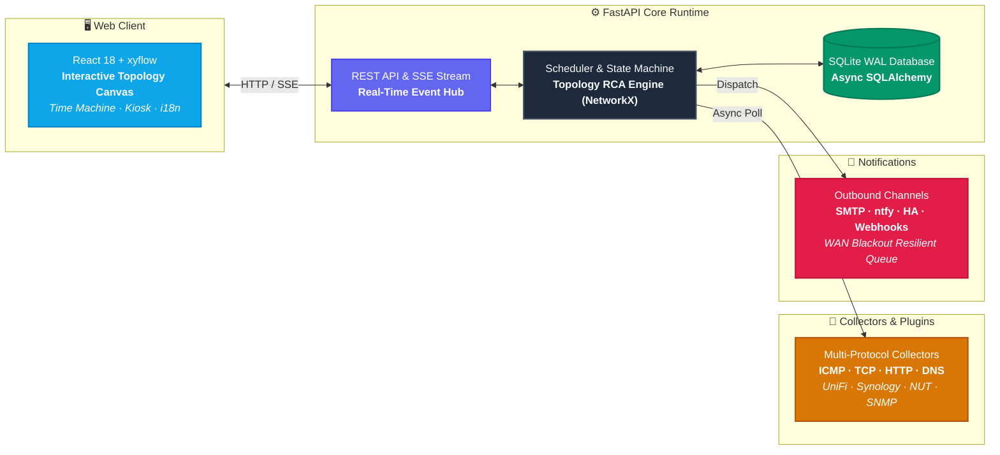
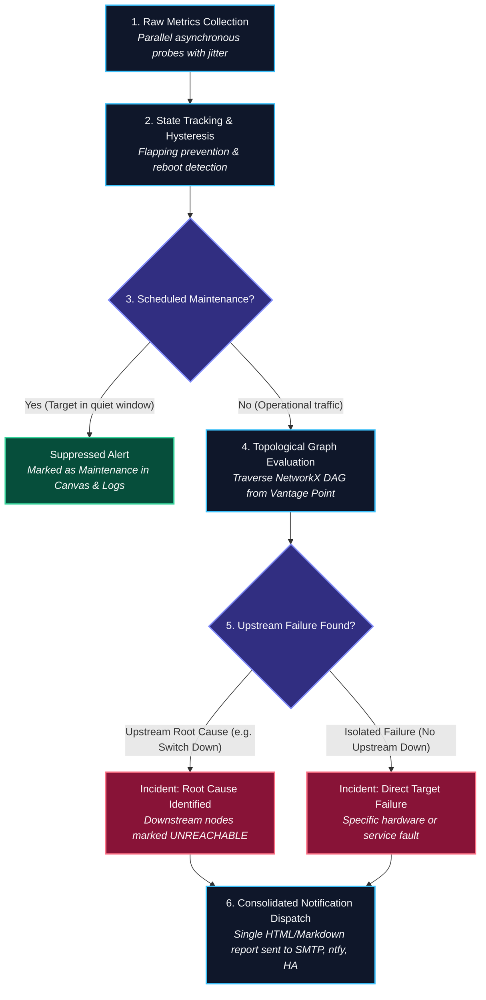

<div align="center">

# 🛡️ NetSentinel

**Intelligent Home Lab & Small Network Monitoring with Topology-Aware Root Cause Analysis**

[](https://github.com/marcomatrella/netsentinel/actions/workflows/ci.yml)
[](https://github.com/marcomatrella/netsentinel/actions/workflows/cd.yml)
[](https://github.com/marcomatrella/netsentinel/pkgs/container/netsentinel)
[](https://python.org)
[](https://fastapi.tiangolo.com)
[](https://react.dev)
[](LICENSE)
[](#-internationalization--languages)

*NetSentinel doesn't just flood you with "Device X is down" alerts. It understands the physical and logical topology of your network and tells you **exactly what failed, why, when, and what action to take**.*

</div>

> [!WARNING]
> **Progetto in sviluppo attivo / Early Stage**  
> NetSentinel è un progetto recente ed è in continua e rapida evoluzione. Potrebbero verificarsi bug, anomalie o comportamenti indesiderati.  
> - Se riscontri problemi o comportamenti imprevisti, ti invitiamo ad **aprire una Issue** su GitHub descrivendo l'accaduto.
> - Contributi e suggerimenti sono i benvenuti! Sentiti libero di effettuare un **fork** del repository e proporre una **Pull Request** per risolvere problemi o implementare nuove funzionalità.

---

## 💡 Why NetSentinel?

In conventional monitoring solutions (Zabbix, Nagios, Uptime Kuma), the failure of an upstream infrastructure device (such as a core switch or main router) triggers an uncontrollable cascade of independent alerts: *"NAS offline"*, *"AP offline"*, *"Home Assistant offline"*, *"DNS resolver down"*, *"DHCP server unreachable"*.

**NetSentinel tackles this problem at the root:**

1. **Distinguishes Root Cause from Symptoms**: Identifies that downstream Access Points and Servers are simply `UNREACHABLE` because the intermediate Switch is `DOWN`. It consolidates the issue into **a single actionable incident** instead of a notification storm.
2. **Interactive Draw.io-Style Canvas**: Drag-and-drop hardware nodes and cables on a modern central canvas. The system **automatically deduces dependencies** (PoE power, Layer 2 paths, Layer 3 gateway, DNS, DHCP).
3. **19 Hardware Categories & 12 Visual Accents**: Dedicated templates for Routers, Firewalls (pfSense/OPNsense), Managed PoE Switches, Access Points, NAS, Hypervisors (Proxmox), Home Assistant, IP Cameras (RTSP), NVRs, Network Printers, Smart Plugs/PDUs, UPS, Fiber Modems/ONTs, and IoT Sensors.
4. **Vantage Point Awareness**: NetSentinel knows its physical location on the LAN (e.g. your Synology NAS or server) and discriminates whether the network has failed or if the vantage point itself has become isolated.
5. **Time Machine (Historical Playback)**: Rewind time across the last 30 days to visually replay how an incident propagated through your topology.
6. **Ultra-Lightweight & NAS-Friendly**: SQLite in WAL mode, batched asynchronous metrics, CPU usage < 3% and RAM footprint < 200MB.
7. **Dead-Man's Switch**: Integrates an external watchdog (e.g. Healthchecks.io) to alert you if NetSentinel itself freezes, loses power, or goes dark.

---

## 🏗️ Architecture

NetSentinel is designed as a modular, lightweight monolithic container split into two core views:

### 1. System & Component Architecture



### 2. Diagnosis & Correlation Pipeline




---
## Quick Demo

https://github.com/user-attachments/assets/6393e4e6-a0b3-46d2-9ae5-577531e9370f


---

## 🚀 Quickstart with Docker

NetSentinel is packaged as a single lightweight multi-arch Docker image containing both the compiled React frontend and the FastAPI backend.

### Option 1: Docker Compose (Recommended)

Create a `docker-compose.yml` file:

```yaml
version: "3.8"

services:
  netsentinel:
    image: ghcr.io/marcomatrella/netsentinel:latest
    container_name: netsentinel
    restart: unless-stopped
    network_mode: host
    cap_add:
      - NET_RAW  # Required for raw ICMP pings without root privileges
    environment:
      - NETSENTINEL_HOST=0.0.0.0
      - NETSENTINEL_PORT=8080
      - NETSENTINEL_DATA_DIR=/data
      - NETSENTINEL_SECRET_KEY=optional_fernet_encryption_key
      - NETSENTINEL_HEARTBEAT_URL=https://hc-ping.com/your-uuid-here
      - TZ=Europe/Rome
    volumes:
      - ./data:/data
```

Start the container:
```bash
docker compose up -d
```

> [!TIP]
> **Deployment on Remote Linux / NAS (Synology DSM, TrueNAS, unRAID, Proxmox)**:
> Always use `network_mode: host` and keep `cap_add: [NET_RAW]`. Do not publish `ports:`, as the container binds directly to the host's port `8080`. This provides zero-overhead latency and enables physical L2 broadcast discovery.
>
> **Persistent Storage Permissions**:
> The container runs as an unprivileged user (`UID 1000`) for container security. On Linux/Synology, ensure the host directory has write permissions:
> ```bash
> mkdir -p ./data && chown -R 1000:1000 ./data
> # or chmod -R 777 ./data
> ```
> Alternatively, you can run the container as root by adding `user: "0:0"` to `docker-compose.yml` (or `--user 0:0` in `docker run`).
>
> **Development on macOS / Windows (Docker Desktop)**:
> Docker Desktop runs in a virtual machine and cannot attach directly to the host's physical network stack. In that case, comment out `network_mode: host` and publish ports with `ports: ["8080:8080"]` instead.

Open your browser at:
```
http://localhost:8080/  (or http://<your-nas-ip>:8080/)
```

### Option 2: Docker Run

```bash
docker run -d \
  --name netsentinel \
  --restart unless-stopped \
  --network host \
  --cap-add NET_RAW \
  -v $(pwd)/data:/data \
  -e NETSENTINEL_PORT=8080 \
  -e TZ=Europe/Rome \
  ghcr.io/marcomatrella/netsentinel:latest
```

---

## ✨ Features & Capabilities

### 🎨 Interactive Topology Canvas
* **Live Operational Mode**: Read-only monitoring view where nodes are locked to prevent accidental movement. Displays live RTT ping latency, operational status rings, and animated link pulses.
* **Edit Mode**: One-click top bar button unlocks node dragging, canvas panning, connection handles, node deletion, and custom positioning.
* **Auto-Layout (ELK.js)**: Automatically organizes complex messy networks into clean hierarchical tiers (WAN → Gateway → Core Switches → Access Points & Servers → Clients).
* **12 Visual Color Accents**: Distinguish boxes at a glance (e.g. Amber for NAS, Violet for Proxmox/VMs, Rose for Firewalls, Orange for UPS, Teal for APs) without overriding health status borders.
* **Custom Checks & Real-Time Diagnostics**: Add specific TCP port checks, HTTP healthcheck URLs, or ICMP pings per device. Executing a test triggers an informative timed toast with actual latency and response metrics.

### 🌐 Internationalization & Languages
Full multi-language support available directly from the header dropdown menu:
* 🇮🇹 **Italiano**
* 🇬🇧 **English**
* 🇫🇷 **Français**
* 🇩🇪 **Deutsch**
* 🇪🇸 **Español**

### 📋 Event Logs & Diagnostic Narrative
* Human-readable, searchable log of all network events, outages, flaps, and recoveries.
* **"Inspect on Canvas"**: Instantly jumps to the corresponding device on the topology map.
* Filter by severity (Critical, Warning, Informational) or search by device name and IP.

### ⏰ Time Machine
* Travel back in time using an interactive slider.
* Reconstructs the exact state of your network at any given moment in the past 30 days to diagnose intermittent failures.

### 🔔 Alerting & Notifications
* **Consolidated Incident Reports**: Sends one clean HTML summary per incident, not a storm of individual device down emails.
* **Supported Channels**: SMTP Email, ntfy, Webhooks, Home Assistant notifications.
* **Quiet Hours**: Mute non-critical notifications at night while allowing critical core failures to pass through.
* **WAN Blackout Queue**: If your internet connection drops, notifications are safely queued on disk and dispatched immediately upon WAN recovery.

---

## 🔍 The 14 Built-In Diagnosis Rules

NetSentinel ships with a declarative YAML rule engine (`default_rules.yaml`):

| Rule | Category | Description |
|---|---|---|
| **01** | WAN | Internet upstream connection lost (ONT/ISP), local gateway healthy |
| **02** | Gateway | Main router / firewall offline or unresponsive |
| **03** | Hardware | Access point reboot detected (uptime reset, crash, or firmware update) |
| **04** | Power / Cable | PoE power loss or Ethernet cable disconnection on AP |
| **05** | Cabling | High-frequency link flapping or degraded cable crimp |
| **06** | Switch | Core network switch offline (all downstream nodes isolated) |
| **07** | Server | NAS offline with simultaneous loss of DNS/DHCP services |
| **08** | Service | Local DNS resolution degraded or upstream SERVFAIL |
| **09** | Service | DHCP lease pool exhausted or server not offering IP addresses |
| **10** | Power | UPS operating on battery power due to mains outage |
| **11** | Vantage Point | Local host running NetSentinel isolated from the LAN |
| **12** | Storage | RAID storage pool degraded or failing S.M.A.R.T. disk attributes |
| **13** | Application | Host reachable via ping but specific HTTP/API service locked up |
| **14** | Maintenance | Scheduled firmware upgrade with planned recovery window |

---

## 🔌 Hardware & Protocol Plugins

NetSentinel includes built-in collectors with zero external dependencies:

* **Ping ICMP**: Native raw socket implementation with sub-millisecond precision and packet-loss calculation.
* **TCP Port**: Connection verification on custom ports (e.g. Proxmox 8006, DSM 5000, RTSP 554, NUT 3493, IPP 631).
* **HTTP / JSONPath**: REST API and web healthcheck verification with response-time tracking.
* **Direct DNS**: Low-level UDP DNS query builder and parser to verify resolver latency and record resolution.
* **Synology DSM**: Native REST API client for storage pool health, disk drive status, temperature, and DSM version.
* **UniFi Controller**: UniFi API integration for Access Point status, PoE port delivery, and client counts.
* **NUT (Network UPS Tools)**: Direct TCP client (port 3493) monitoring UPS battery charge, load, and grid status.
* **SNMP v1/v2c**: Pure Python UDP SNMP packet builder and parser for network interface statistics.
* **AdGuard Home & Home Assistant**: Native API integrations for DNS block rates and smart plug power metrics.

---

## ⚙️ Configuration Reference

| Environment Variable | Default | Description |
|---|---|---|
| `NETSENTINEL_HOST` | `0.0.0.0` | Binding host address |
| `NETSENTINEL_PORT` | `8080` | Web server listening port |
| `NETSENTINEL_DATA_DIR` | `/data` | Directory where SQLite DB and backups are stored |
| `NETSENTINEL_SECRET_KEY` | *(auto-generated)* | 32-byte Fernet key used to encrypt passwords & API tokens in DB |
| `NETSENTINEL_HEARTBEAT_URL` | `None` | External watchdog URL (e.g. Healthchecks.io ping URL) |
| `NETSENTINEL_LOG_LEVEL` | `INFO` | Logging level (`DEBUG`, `INFO`, `WARNING`, `ERROR`) |
| `TZ` | `UTC` | Local timezone (e.g. `Europe/Rome`, `America/New_York`) |

---

## 🛠️ Development & Testing

NetSentinel uses [uv](https://github.com/astral-sh/uv) for lightning-fast Python package management and [Vite](https://vitejs.dev) for frontend builds.

```bash
# Clone the repository
git clone https://github.com/marcomatrella/netsentinel.git
cd netsentinel

# Set up Python virtual environment and install dev dependencies
uv sync --all-extras --dev

# Run unit tests, scenario correlations, and benchmarks (50 tests)
uv run pytest

# Run code style and linter checks
uv run ruff check .

# Frontend development
cd frontend
npm install
npm run dev
```

---

## 📄 License

This project is licensed under the **MIT License**. See the [LICENSE](LICENSE) file for details.
