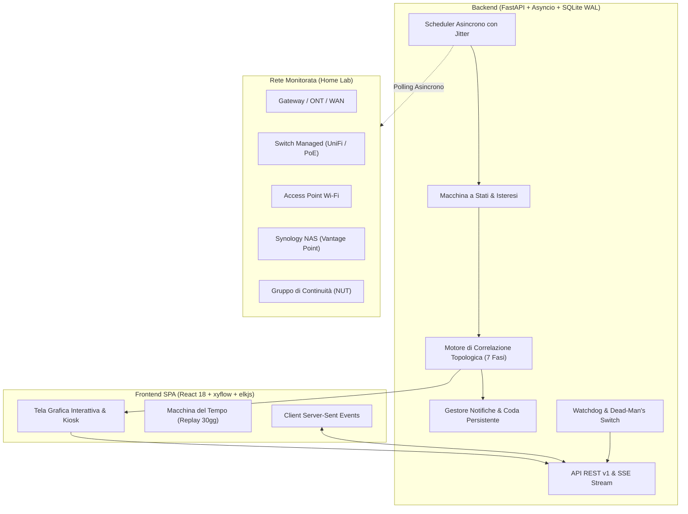

# NetSentinel — Architettura del Sistema

## 1. Visione d'Insieme

NetSentinel è un'applicazione self-hosted progettata specificamente per ambienti home lab e reti domestiche avanzate. A differenza dei sistemi di monitoraggio tradizionali che generano tempeste di allarmi disconnessi (*"AP offline"*, *"DNS offline"*, *"Server offline"*), NetSentinel sfrutta la **topologia fisica e logica della rete** per isolare la **causa radice (root cause)** distinguendola dai sintomi a valle.

---

## 2. Principi Fondamentali

1. **Generico e Config-Driven**: Zero parametri, marchi o IP hard-coded. Qualsiasi elemento della rete vive come entità nel database ed è esportabile/importabile in YAML versionato (`netsentinel.yaml`).
2. **Onestà sulla Conoscenza**: Chiara differenziazione degli stati:
   - `OK`: Verificato sano e funzionante.
   - `DOWN`: Confermato guasto a monte (causa radice).
   - `UNREACHABLE`: Irraggiungibile per guasto dell'infrastruttura di commutazione (L2/L3).
   - `AFFECTED`: Impattato logicamente per mancata fornitura di un servizio o alimentazione (power, dns, dhcp).
   - `UNKNOWN`: Nessuna informazione affidabile disponibile.
3. **Punto di Osservazione (Vantage Point)**: NetSentinel monitora la rete a partire da un nodo ben preciso (tipicamente un NAS o home server). La topologia è orientata radialmente rispetto a tale punto. Se il vantage point stesso si ritrova isolato, NetSentinel lo riconosce immediatamente (Regola 11).
4. **Sola Lettura**: NetSentinel non modifica mai la configurazione dei dispositivi monitorati (nessuna scrittura su router o switch).
5. **Minimo Impatto su Disco (NAS Friendly)**: Database SQLite in modalità `WAL` (`synchronous=NORMAL`), osservazioni grezze scritte in batch asincroni con retention breve (7 giorni) e aggregazione oraria compressa (90 giorni). Uso CPU < 3% e RAM < 200MB.

---

## 3. Modello Dati e Topologia di Rete

NetSentinel modella la rete come un grafo orientato memorizzato in SQLite e gestito in memoria tramite **NetworkX** (`TopologyGraph`):

- **Device**: Nodi fisici o logici con coordinate grafiche, tipologia (`kind`), ruoli (`wan_provider`, `gateway`, `dns_resolver`, `dhcp_server`), criticità (1-5) e indirizzi.
- **Link**: Archi fisici o di collegamento con medium (`ethernet`, `poe`, `wifi`, `wan`, `power`, `logical`), stato e porte negoziate.
- **Dependency**: Relazione orientata dipendente → fornitore (`power`, `l2_path`, `l3_gateway`, `wan`, `dhcp`, `dns`, `service`).
- **Check**: Controlli periodici eseguiti asincronamente con intervallo, timeout e politiche di isteresi (`consecutive_failures` prima del passaggio di stato).
- **Incident**: Record unificato di incidente con causa radice, confidenza statistica, cronologia eventi, evidenze e raccomandazioni.

---

## 4. Pipeline di Correlazione ed Eventi

Ogni ciclo di valutazione dello scheduler attraversa l'algoritmo in 7 fasi (documentato in dettaglio in `docs/correlation.md`):

1. **Fase 1 (Check & Isteresi)**: Rilevamento fallimenti con soppressione del rumore e rilevamento flapping/reboot.
2. **Fase 2 (Sintesi Stato Nodi)**: Aggregazione dei check del dispositivo.
3. **Fase 3 (Verifica Isolamento Vantage Point)**: Controllo connettività immediata dell'host del monitor.
4. **Fase 4 (Discriminazione Causa vs Sintomo)**: Un nodo non sano i cui provider sono guasti viene marcato `UNREACHABLE` o `AFFECTED` e rimosso dalle cause radice.
5. **Fase 5 (Valutazione Regole e Confidenza)**: Applicazione della libreria dichiarativa YAML (`default_rules.yaml`) con ponderazione delle evidenze.
6. **Fase 6 (Ciclo di Vita Incidenti)**: Deduplica, apertura o aggiornamento (rilevamento shift causa) o risoluzione automatica.
7. **Fase 7 (Notifica)**: Invio su canali configurati, verifica quiet hours e buffering in caso di assenza WAN.

---

## 5. Streaming in Tempo Reale & Macchina del Tempo

- **Server-Sent Events (SSE)**: La rotta `/api/v1/stream` emette frame differenziali (`event: status_diff`) ogni 2 secondi, permettendo alla dashboard React di aggiornare lo stato di nodi e archi senza sovraccaricare il server di polling HTTP.
- **Macchina del Tempo**: Tramite `/api/v1/timemachine/snapshot?target_time=...`, l'utente può scorrere lo slider temporale fino a 30 giorni nel passato per visualizzare esattamente come appariva la rete durante un guasto storico.

