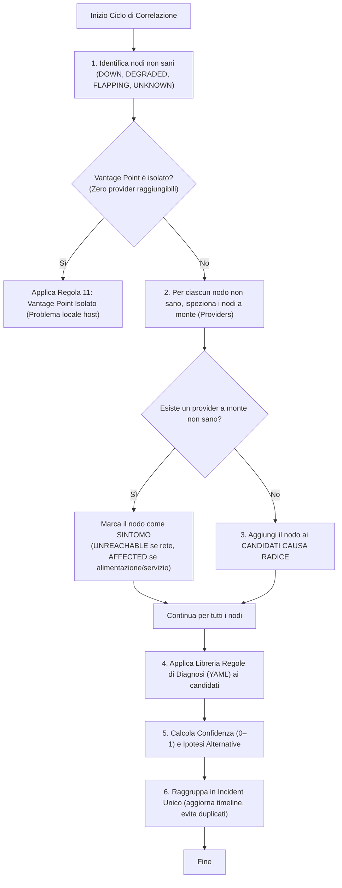

# NetSentinel — Algoritmo di Correlazione e Root Cause Analysis

## 1. Il Problema della Diagnosi di Rete

Nei sistemi di monitoraggio convenzionali (es. Nagios, Zabbix, Uptime Kuma), un guasto a un apparato infrastrutturale a monte (come uno switch o un gateway) scatena una cascata incontrollata di allarmi separati: *"NAS offline"*, *"AP offline"*, *"Server domotico offline"*, *"DNS offline"*, *"DHCP offline"*.

L'utente riceve decine di notifiche contemporanee e non è in grado di capire a colpo d'occhio:
- **Dov'è** la causa radice primaria.
- **Perché** gli altri apparati risultano non raggiungibili (sono sintomi, non guasti).
- **Cosa fare** immediatamente per ripristinare il servizio.

NetSentinel risolve questo problema attraverso il **Grafo Orientato delle Dipendenze** e l'**Algoritmo di Root Cause Analysis (Sezione 6.3)**.

---

## 2. Il Grafo delle Dipendenze

Il grafo $G = (V, E)$ è un grafo orientato in cui:
- Ogni vertice $v \in V$ rappresenta un apparato (`Device`).
- Ogni arco orientato $(u, v) \in E$ esprime una relazione di dipendenza: **"$u$ dipende da $v$ per la capacità $K$"**.

I tipi di dipendenza supportati includono:
- `power`: dipendenza energetica (es. AP alimentato da iniettore PoE, apparati alimentati da UPS).
- `l2_path`: percorso di commutazione Layer 2 (switch, bridge, cavo Ethernet).
- `l3_gateway`: instradamento verso altre reti o verso Internet.
- `wan`: connettività Internet fornita dall'operatore (ISP).
- `dns`: risoluzione dei nomi di dominio (es. AdGuard Home, Pi-hole).
- `dhcp`: assegnazione e rinnovo degli indirizzi IP.
- `service`: dipendenza applicativa o soft-dependency (es. controller UniFi per gli AP).

### Il Ruolo del "Vantage Point"

NetSentinel opera da un punto di osservazione specifico nella rete (il **Vantage Point**, tipicamente il NAS o un server locale). La raggiungibilità e le distanze topologiche (hop count) sono calcolate orientandosi a partire dal Vantage Point verso la periferia della rete.

---

## 3. L'Algoritmo di Root Cause (Passo-Passo)

L'algoritmo viene eseguito a ogni ciclo o a ogni transizione di stato di un controllo:



### Dettaglio delle Fasi

1. **Rilevamento Nodi Non Sani**:
   Vengono selezionati tutti i dispositivi il cui stato sintetico è `DOWN`, `FLAPPING`, `DEGRADED` o `UNKNOWN`.

2. **Ispezione a Monte e Isolamento dei Sintomi**:
   Per ciascun apparato non sano $u$:
   - Si cercano i suoi provider a monte $p \in \text{Upstream}(u)$.
   - Se almeno un provider $p$ è a sua volta non sano, $u$ **non è la causa radice**, bensì una vittima del guasto a monte.
   - Il suo stato viene aggiornato con onestà a `UNREACHABLE` (se la dipendenza è di rete `l2_path` o `l3_gateway`) oppure ad `AFFECTED` (se la dipendenza è `power` o `service`).

3. **Individuazione dei Candidati Causa Radice**:
   I nodi non sani che **non hanno alcun provider a monte non sano** sono i veri candidati alla causa radice.

4. **Applicazione delle Regole Dichiarative**:
   Per ciascun candidato viene selezionata la regola più specifica dal file `default_rules.yaml` (o regole personalizzate) confrontando il tipo di apparato, le evidenze positive (es. nodi vicini sani) e negative.

5. **Calcolo della Confidenza ed Evidenze**:
   Ogni diagnosi produce una confidenza numerica da 0 a 1 e un insieme strutturato di raccomandazioni operative (*"Cosa fare adesso"*). Se la confidenza è inferiore a 0.90, vengono generate ipotesi alternative ordinate.

6. **Gestione del Ciclo di Vita dell'Incidente**:
   Tutti i sintomi e le evidenze correlate convergono in un **singolo `Incident`**.
   - Se un incidente per quell'area è già aperto, viene aggiornato senza inviare notifiche duplicate.
   - Se la causa radice cambia durante il guasto (es. prima sembrava l'AP, poi si è scoperto che lo switch a monte è spento), l'incidente esegue un **root cause shift** conservando la cronologia completa.
   - Quando tutti gli apparati tornano sani, l'incidente viene marcato come `resolved` con timestamp di chiusura e durata complessiva.

---

## 4. Come Aggiungere Nuove Regole di Diagnosi

Le regole sono definite in formato dichiarativo YAML in `backend/app/correlation/rules/default_rules.yaml`. Per aggiungere una nuova regola:

```yaml
- id: "rule_custom_nas_fan_failure"
  category: "hardware"
  name: "Guasto Ventola di Raffreddamento NAS"
  target_kind: ["nas"]
  confidence_base: 0.92
  title: "Ventola di raffreddamento del NAS ferma o in allarme"
  summary: "Il sensore tachimetrico della ventola principale del NAS segnala 0 RPM o temperatura elevata."
  recommendations:
    - "Verifica che le griglie di aerazione del NAS non siano ostruite da polvere."
    - "Sostituisci la ventola tachimetrica prima che i dischi superino la soglia termica critica."
  alternative_hypotheses:
    - category: "environment"
      description: "Temperatura ambiente insolitamente elevata nel locale rack."
      confidence: 0.08
```
