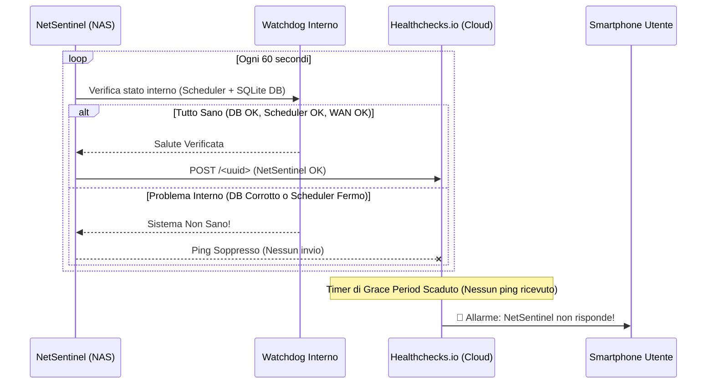

# NetSentinel — Dead-Man's Switch e Monitoraggio del Monitor

Un principio fondamentale di NetSentinel è: **"Chi controlla il controllore?"**.
Se il NAS si blocca, salta la corrente o il container NetSentinel va in stallo, il monitor non può ovviamente inviare una notifica locale per dire che è morto. Per questo NetSentinel integra un **Dead-Man's Switch esterno** (interruttore dell'uomo a terra).

---

## 1. Come Funziona

NetSentinel invia un ping HTTP periodico (ogni 60 secondi) verso un servizio esterno indipendente come [Healthchecks.io](https://healthchecks.io), UptimeRobot o simile.

Se il servizio esterno non riceve il ping entro l'intervallo previsto (es. 2 minuti), attiva immediatamente un allarme tramite email, Telegram, SMS o push verso lo smartphone dell'utente, segnalando:
> *"NetSentinel (Home Lab) non risponde: il monitor centrale è offline o bloccato!"*



---

## 2. Watchdog a Due Livelli

Il ping verso il dead-man's switch **non è un semplice loop stupido**. Prima di trasmettere il segnale di vita al cloud, il **Watchdog interno** verifica:

1. **Reattività del Database SQLite**: Esegue una query asincrona reale `SELECT 1` per confermare che i file di lock/WAL non siano corrotti o congelati su disco.
2. **Ciclo dello Scheduler Asincrono**: Verifica che il worker pool non sia andato in deadlock o non sia terminato per eccezioni non gestite.

Se anche uno solo di questi controlli fallisce, il watchdog **blocca l'invio del ping** e chiama l'endpoint `/fail` di Healthchecks.io, provocando l'allarme immediato.

---

## 3. Configurazione con Healthchecks.io

1. Crea un account gratuito su [Healthchecks.io](https://healthchecks.io).
2. Crea un nuovo controllo con nome `"NetSentinel Home Lab"`:
   - **Period**: `1 minute`
   - **Grace Time**: `2 minutes`
3. Copia l'URL del ping generato (es. `https://hc-ping.com/12345678-abcd-ef01-2345-6789abcdef01`).
4. Configuralo in NetSentinel:
   - Nel file `docker-compose.yml`:
     ```yaml
     environment:
       - NETSENTINEL_HEARTBEAT_URL=https://hc-ping.com/12345678-abcd-ef01-2345-6789abcdef01
       - NETSENTINEL_HEARTBEAT_INTERVAL_SECONDS=60
     ```
   - Oppure dal wizard nella schermata "Vantage Point & Heartbeat".
5. Verifica lo stato del battito cardiaco nell'API:
   ```bash
   curl http://localhost:8080/api/v1/heartbeat/status
   ```
